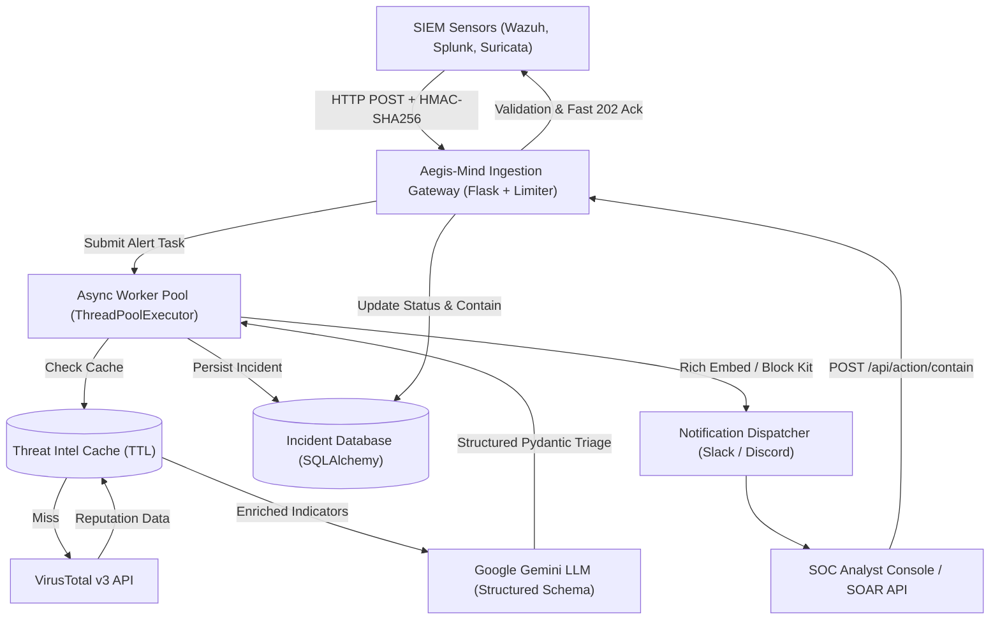

# Aegis-Mind Architecture & Engineering Specification

## 1. Executive Overview

**Aegis-Mind** is an autonomous Security Operations Center (SOC) Alert Triage and Incident Response (SOAR) platform. It bridges raw SIEM/sensor alerts with contextualized external threat intelligence and Google Gemini's reasoning capabilities, generating deterministic, structured MITRE ATT&CK assessments and immediate containment recommendations.



---

## 2. Component Breakdown

### A. Ingestion Gateway (`app.py`)
- **Protocol**: RESTful HTTP Webhook (`/api/alert`).
- **Signature Verification**: Validates HMAC-SHA256 signatures (`X-Aegis-Signature` header) using `WEBHOOK_SECRET` to prevent spoofing and unauthorized alert injection.
- **Input Validation**: Strict schema enforcement using Pydantic `AlertPayload`. Rejects malformed or incomplete logs with `400 Bad Request`.
- **Rate Limiting**: Integrated `Flask-Limiter` protects against alert floods and DoS.
- **Asynchronous Decoupling**: Returns `202 Accepted` + `incident_uuid` in `<20ms`, delegating heavy I/O to a 10-thread worker pool.

### B. Threat Intelligence Engine (`threat_intel.py`)
- **TTL Cache**: High-performance in-memory cache (`cachetools.TTLCache`) caching IP reputations for configurable TTL (default 1 hour).
- **Rate Limit Defense**: Prevents exhausting external provider quotas (e.g. VirusTotal 4 req/min).
- **RFC1918 Private IP Detection**: Automatically handles internal non-routable ranges without sending internal network metadata to third parties.
- **Known Scanner Tagging**: Identifies benign internet scanners (Shodan, Censys, Project Sonar) to filter false positives.

### C. AI Triage Engine (`llm_analyzer.py`)
- **Model**: Google Gemini 3.5 Flash / 2.5 Flash via official `google-genai` SDK.
- **Structured Output**: Employs `response_schema=TriageReport` to guarantee strictly typed JSON adhering to Pydantic models.
- **Outputs Produced**:
  - `severity`: Standardized classification (`LOW`, `MEDIUM`, `HIGH`, `CRITICAL`).
  - `confidence_score`: Float between `0.0` and `1.0`.
  - `is_false_positive`: Boolean flag indicating benign activity.
  - `mitre_tactic`, `mitre_technique_id`, `mitre_technique_name`: Grounded mapping to MITRE ATT&CK framework.
  - `recommended_containment`: Actionable command/policy for firewall or EDR.
  - `auto_containment_recommended`: Boolean indicator for automated action.
- **Deterministic Fallback**: Automatically activates rule-based heuristic scoring if the LLM API is unreachable.

### D. Incident Database (`database.py` & `models.py`)
- **ORM**: SQLAlchemy supporting SQLite for local operation and PostgreSQL for enterprise deployment.
- **Stored Fields**: UUID, timestamps, indicator IP, SIEM rule metadata, threat intelligence payload, severity, MITRE mappings, analyst audit logs, and resolution lifecycle status (`TRIAGED`, `BLOCK_IP`, `FALSE_POSITIVE`).

### E. Alert Dispatcher (`notifier.py`)
- **Discord**: Color-coded Rich Embeds with severity badges, ASN lookup, VT engine breakdown, and API containment commands.
- **Slack**: Structured Slack Block Kit cards with interactive sections and context markers.
- **Console Simulation**: Terminal output with structured banners for offline development.

---

## 3. REST API Specification

### `POST /api/alert`
Ingests a SIEM security event.
- **Headers**:
  - `Content-Type: application/json`
  - `X-Aegis-Signature: sha256=<hex>` *(Optional / Required if `REQUIRE_HMAC=true`)*
- **Response**: `202 Accepted`
```json
{
  "incident_uuid": "e93d7c34-319d-472e-9dcb-94a2f8b50dfb",
  "status": "accepted",
  "message": "Alert queued for autonomous triage and threat intel enrichment"
}
```

### `GET /healthz`
Health check and cache metrics.
- **Response**: `200 OK`
```json
{
  "service": "Aegis-Mind SOAR",
  "status": "healthy",
  "version": "2.0.0",
  "cache": {
    "entries_cached": 14,
    "max_size": 1000,
    "ttl_seconds": 3600
  }
}
```

### `GET /api/incidents`
Lists recently triaged security incidents.
- **Query Params**: `limit` (int, default 25, max 100).
- **Response**: `200 OK`

### `POST /api/action/contain`
Executes analyst response action (SOAR).
- **Payload**:
```json
{
  "incident_uuid": "e93d7c34-319d-472e-9dcb-94a2f8b50dfb",
  "action": "BLOCK_IP",
  "analyst_notes": "Confirmed unauthorized SSH brute force from known bulletproof host."
}
```
- **Response**: `200 OK`

---

## 4. Production Deployment Best Practices

### Running with a Production WSGI Server (Gunicorn)
Do not use the Flask development server in production. Run with Gunicorn:
```bash
gunicorn -w 4 -k gthread --threads 4 -b 0.0.0.0:5000 app:app
```

### Docker Containerization
```dockerfile
FROM python:3.11-slim
WORKDIR /app
COPY requirements.txt .
RUN pip install --no-cache-dir -r requirements.txt
COPY . .
EXPOSE 5000
CMD ["gunicorn", "-w", "4", "-k", "gthread", "--threads", "4", "-b", "0.0.0.0:5000", "app:app"]
```
