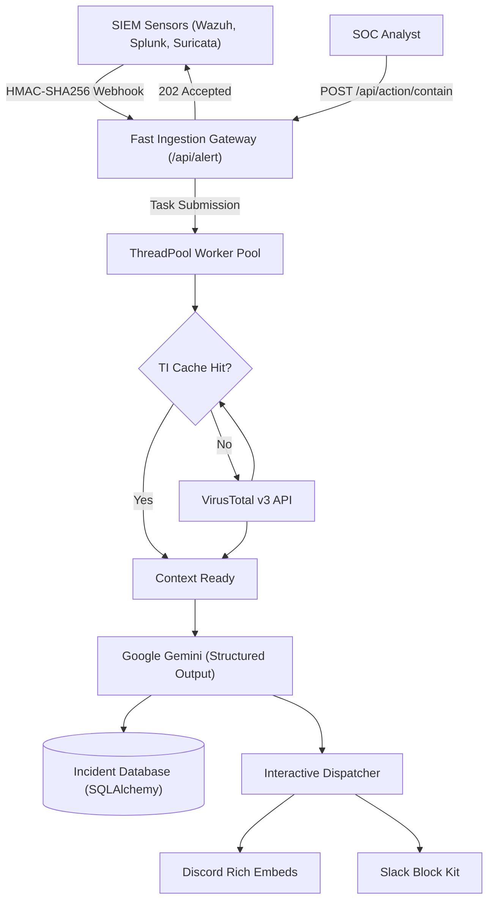

# Aegis-Mind 🛡️🧠

**Aegis-Mind** is an enterprise-grade autonomous AI-powered Security Operations Center (SOC) Alert Triage and Incident Response (SOAR) platform. It intercepts raw security events from SIEM tools (Wazuh, Splunk, Elastic, honeypots), enriches indicators in real-time with threat intelligence (VirusTotal v3 with TTL caching), performs grounded autonomous triage and MITRE ATT&CK mapping via Google Gemini's Structured Output, and dispatches rich interactive alerts to Slack and Discord.

---

## 🚀 Key Features

- **⚡ High-Performance Asynchronous Ingestion**: Fast `202 Accepted` response (<20ms) with background task execution pool to handle high-volume alert storms without dropping events.
- **🔐 Webhook Security & Integrity**: Built-in HMAC-SHA256 signature verification (`X-Aegis-Signature`) to block unauthorized or spoofed alert submissions.
- **🧠 Grounded AI Triage via Google Gemini**: Uses Gemini's structured output (`response_schema`) to output strictly typed JSON containing severity ratings, confidence scores, false-positive detection, and MITRE ATT&CK taxonomy.
- **🛡️ Threat Intelligence with TTL Caching**: High-efficiency in-memory cache prevents exhausting VirusTotal API quotas (4 req/min limit) and cuts repeat lookup latencies to 0ms.
- **🏷️ RFC1918 & Scanner Filtering**: Identifies internal non-routable IPs and tags known benign research scanners (Shodan, Censys, Project Sonar) to suppress alarm fatigue.
- **💾 Persistent Incident Store**: Full SQLite / PostgreSQL audit trail powered by SQLAlchemy, recording all alerts, triage assessments, and analyst responses.
- **🎯 Interactive SOAR Notifications**: Color-coded Discord Rich Embed cards and Slack Block Kit messages with instant containment trigger commands.
- **🛡️ Analyst Containment Endpoint**: `/api/action/contain` allows analysts to log containment actions (`BLOCK_IP`, `ISOLATE_HOST`, `FALSE_POSITIVE`).

---

## 🏗️ Architecture Overview



*For detailed technical diagrams and data flows, see [ARCHITECTURE.md](ARCHITECTURE.md).*

---

## 📁 Project Structure

```text
Aegis-Mind/
├── app.py              # Asynchronous Flask SOAR gateway with HMAC verification & REST API
├── config.py           # Centralized configuration & environment loader
├── models.py           # Pydantic validation schemas & SQLAlchemy ORM models
├── database.py         # Database initialization, incident queries, and status updates
├── threat_intel.py     # VirusTotal v3 IP/Hash enrichment with TTL caching
├── llm_analyzer.py     # Google Gemini AI triage with Pydantic structured output
├── notifier.py         # Discord Rich Embeds & Slack Block Kit notification dispatcher
├── simulate_alert.py   # Multi-scenario attack simulator with HMAC signature generation
├── requirements.txt    # Production dependencies
├── .env.example        # Environment configuration template
├── .gitignore          # Strict exclusions for secrets, credentials, and local databases
├── LICENSE             # MIT License
├── ARCHITECTURE.md     # Detailed architecture and engineering specifications
└── README.md           # Project documentation
```

---

## ⚙️ Installation & Setup

### 1. Clone the repository
```bash
git clone https://github.com/KishanAmbaliyaa/Aegis-Mind.git
cd Aegis-Mind
```

### 2. Set up virtual environment
```bash
python -m venv venv
# On Windows:
.\venv\Scripts\activate
# On Linux/macOS:
source venv/bin/activate
```

### 3. Install dependencies
```bash
pip install -r requirements.txt
```

### 4. Configure environment variables
Copy `.env.example` to `.env`:
```bash
cp .env.example .env
```
Update `.env` with your API credentials:
```env
VIRUSTOTAL_API_KEY=your_virustotal_key
GEMINI_API_KEY=your_gemini_api_key
GEMINI_MODEL=gemini-3.5-flash
SLACK_WEBHOOK_URL=your_slack_webhook
DISCORD_WEBHOOK_URL=your_discord_webhook
WEBHOOK_SECRET=your_hmac_secret
REQUIRE_HMAC=false
DATABASE_URL=sqlite:///aegis_mind.db
```

---

## 🏃 Running Aegis-Mind

### 1. Start the SOAR Gateway
```bash
python app.py
```
*The service starts listening on `http://0.0.0.0:5000` with the SQLite database initialized.*

### 2. Run the Multi-Scenario Simulation Suite
In another terminal, trigger simulated alerts:
```bash
# Simulate an SSH brute force attack
python simulate_alert.py ssh_brute_force

# Simulate a web exploit attempt (Log4j / RCE)
python simulate_alert.py web_cve_exploit

# Simulate a benign scanner (Shodan / Censys)
python simulate_alert.py benign_scanner
```

### 3. Check System Health & Incidents
```bash
# Health check & cache statistics
curl http://127.0.0.1:5000/healthz

# List recent triaged incidents
curl http://127.0.0.1:5000/api/incidents
```

### 4. Execute Containment Action (Analyst SOAR)
```bash
curl -X POST http://127.0.0.1:5000/api/action/contain \
  -H "Content-Type: application/json" \
  -d '{"incident_uuid": "<INCIDENT_UUID>", "action": "BLOCK_IP", "analyst_notes": "Confirmed malicious brute force"}'
```

---

## 📄 License

This project is licensed under the MIT License - see the [LICENSE](LICENSE) file for details.
